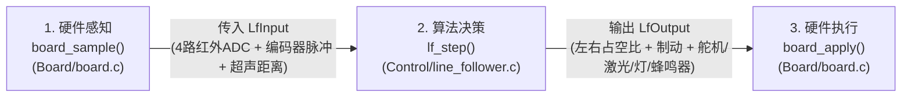

# 软件工作区代码全景说明书（供全组同学快速上手）

本文档对 `firmware/line-following-car` 工作区中的每一个文件夹、每一个源码文件、核心数据结构及控制函数进行通俗且详尽的说明。组员无需事先精通 C 语言或阅读冗长的 STM32 寄存器手册，只需阅读本文档即可对整套固件的运作机制了如指掌。

---

## 1. 工作区目录与文件总览

```text
line-following-car/
├── Board/                          # 【底层硬件驱动层 (BSP)】：只与 STM32G474 外设寄存器打交道
│   ├── board.h                     # 硬件驱动对外提供的统一函数接口声明
│   ├── board.c                     # 时钟、TIM1/2/3/4/6/8/17、ADC1+DMA、USART1(HC-04自适应)、Flash 存储实现
│   ├── lcd_st7735.h / .c           # 1.8寸 ST7735S LCD (SPI1 10MHz, 128x160 竖屏) 脏区分片非阻塞遥测显示驱动
│   └── lcd_font.h                  # 6x12 与 8x16 ASCII 点阵字库（源自 ZJY180S0800TG01 例程）
├── Control/                        # 【核心控制与状态机层】：纯算法模块，与单片机硬件解耦，可在电脑上直接测试
│   ├── bridge_logic.h              # DRV8833 双 H 桥驱动芯片 PWM 占空比映射接口
│   ├── bridge_logic.c              # 驱动/制动（慢衰减）与驱动/滑行（快衰减）比较值换算实现
│   ├── line_follower.h             # 控制器状态机、参数配置、里程计、输入/输出结构体定义
│   └── line_follower.c             # 快速循迹 PID、左右轮独立死区自动标定、超声停车、四面打靶实现
├── Core/                           # 【顶层应用与交互层】：连接底层硬件与控制算法的总调度室
│   ├── Inc/
│   │   └── stm32g4xx_hal_conf.h    # STM32 官方 HAL 库模块启用配置文件
│   └── Src/
│       ├── main.c                  # 200 Hz 主循环调度、按键消抖、蓝牙串口命令解析、10 Hz CSV 遥测
│       └── syscalls.c              # C 标准库底层桩函数（供 printf/vsnprintf 格式化使用）
├── Drivers/                        # 【ST 官方底层库】：CMSIS 内核头文件与 STM32G4xx HAL 驱动源码（无需修改）
├── tests/                          # 【电脑主机端自动化测试】：用电脑 GCC 直接验证控制算法的 25 项单元测试
│   ├── CMakeLists.txt              # 主机测试工程构建脚本
│   └── test_controller.c           # 25 项边界、地面优先模型与硬件模拟PID数字孪生单元测试源码
├── tools/                          # 【编译构建与蓝牙上位机软件】
│   ├── build.ps1                   # 一键编译（Debug/Release）、运行单元测试（-Test）、烧录（-Flash）脚本
│   └── host_station.py             # Python 蓝牙闭环上位机：空载/地面5轮标定、曲线绘制、前馈验证与纯硬件PID优化器
├── data/                           # 上位机自动归档保存的标定 JSON 与赛道 CSV 遥测数据目录
├── docs/                           # 【工程设计文档与硬件映射台账】
│   ├── codebase-guide.md           # 本文档：软件工作区代码全景说明书
│   ├── hardware-interface-manual.md# 硬件开发板与 MCU 引脚逐脚对接详单
│   ├── hardware-optimization-and-next-pcb-plan.md # 现板改焊方案、下一版 PCB 优化方向与按键/输出快速排错手册
│   ├── software-architecture-and-review.md # 软件架构审查与快速循迹优化设计文档
│   ├── board-pin-map.csv           # 全车 27 项 MCU 引脚、核心板排针、主板网络与复用功能速查表
│   ├── live-main-netlist.json      # 从嘉立创 EDA 导出的主扩展板实时网表（只读基准）
│   ├── hardware-relevant-parts.json# 主扩展板关键接插件与芯片引脚连接提取
│   └── validation.json             # 编译产物 SHA-256、clangd 静态检查与单元测试/静态检查记录
├── .vscode/                        # 【VS Code 开发环境配置】
│   ├── tasks.json                  # 编译、测试、一键 ST-LINK 下载任务配置
│   ├── launch.json                 # ST-LINK 在线单步调试与 Live Watch 实时监控配置
│   ├── settings.json               # CMake、Ninja 与 starm-clangd 智能提示配置
│   └── extensions.json             # 推荐安装的 VS Code 插件清单（含 Serial Monitor）
├── CMakeLists.txt                  # 固件 CMake 主构建文件
├── CMakePresets.json               # Debug 与 Release 构建预设
├── STM32G474VETX_FLASH.ld          # 链接脚本（前 508 KB 存放程序代码，顶部 4 KB 预留给掉电参数保存）
└── README.md                       # 实车操作、ST-LINK 下载/调试、Serial Monitor 蓝牙调参完整手册
```

---

## 2. 三层软件架构：数据是怎么流动的？

整套软件严格划分为 **三层**，每隔 **5 毫秒（即每秒 200 次，200 Hz）** 完成一次完整的“感知 → 决策 → 执行”闭环：



1. **第一步：硬件感知 `board_sample(&sample)`（位于 [Board/board.c](file:///c:/Users/Seraphina/Documents/ESD/firmware/line-following-car/Board/board.c)）**
   - 读取已经过 DMA 5 次硬件平均的四路红外 ADC 值 `raw[0..3]`（`0 ~ 4095`）。
   - 读取左轮（`TIM4`）、右轮（`TIM3`）编码器在过去 5 ms 内走过的脉冲数 `encoder_delta[0..1]`。
   - 读取 `DRV8833` 电机驱动芯片是否报错（`PC4` 引脚），以及 `TIM8` 硬件捕获到的最新超声波障碍物距离 `obstacle_mm`。
2. **第二步：算法决策 `lf_step(&g_lf, &sample, now, dt)`（位于 [Control/line_follower.c](file:///c:/Users/Seraphina/Documents/ESD/firmware/line-following-car/Control/line_follower.c)）**
   - 根据当前所处的状态（如红外校准 `LF_CALIBRATING`、电机死区标定 `LF_MOTOR_CAL`、正常循迹 `LF_TRACKING`、障碍物停车 `LF_OBSTACLE_STOP`、四面打靶 `LF_PROBING`），计算出本周期应该给左右电机的占空比 `duty[0..1]`、是否主动电磁制动 `brake`，以及停车灯、蜂鸣器、激光和云台舵机的控制指令，填入 `g_lf.out`。
3. **第三步：硬件执行 `board_apply(&g_lf.out, &g_lf.cfg)`（位于 [Board/board.c](file:///c:/Users/Seraphina/Documents/ESD/firmware/line-following-car/Board/board.c)）**
   - 调用 [Control/bridge_logic.c](file:///c:/Users/Seraphina/Documents/ESD/firmware/line-following-car/Control/bridge_logic.c) 中的 `bridge_compare()`，把占空比转换成 `TIM1` 四个通道的 PWM 寄存器值，同步更新给 `DRV8833` 驱动电机，并更新停车灯、蜂鸣器、激光和舵机引脚。

---

## 3. 各源码文件与核心代码块详解

### 3.1 [Control/bridge_logic.h](file:///c:/Users/Seraphina/Documents/ESD/firmware/line-following-car/Control/bridge_logic.h) 与 [Control/bridge_logic.c](file:///c:/Users/Seraphina/Documents/ESD/firmware/line-following-car/Control/bridge_logic.c)
- **作用**：将范围在 `[-1.0, +1.0]` 的电机占空比指令，翻译成 `DRV8833` H 桥芯片两个输入端（`IN1`、`IN2`）的 PWM 计数值（`0 ~ 4000`）。
- **核心原理**：
  - 当需要**主动电枢短接刹车（`brake = true`）**时，令 `IN1 = 4000, IN2 = 4000`（即 `11` 状态），此时 H 桥把电机正负极直接短接，电机旋转产生的反电动势形成强大的电磁制动扭矩，实现 `<15cm` 瞬时刹停。
  - 在正常驱动时，默认采用 **`drive_brake = true`（驱动/制动模式，即慢衰减 Slow Decay）**：正转时 `IN1` 保持高电平 `4000`，`IN2` 输出 `4000 - active`。这样在 PWM 的关断间隙电机处于续流制动状态，不僅使“占空比—转速”关系更加线性，而且在连续 S 弯内轮减小占空比时能立即提供减速力，防止内轮滑行冲出赛道。

### 3.2 [Control/line_follower.h](file:///c:/Users/Seraphina/Documents/ESD/firmware/line-following-car/Control/line_follower.h) 与 [Control/line_follower.c](file:///c:/Users/Seraphina/Documents/ESD/firmware/line-following-car/Control/line_follower.c)
这是整个工程最核心的算法文件，内部按注释清晰划分为 **9 个独立功能模块**：

1. **模块 1 & 2：基础工具与配置校验（`lf_default_config`, `lf_config_valid`）**
   - 集中定义所有默认控制参数，并在每次运行前检查参数是否在安全范围内（如最大占空比不能超过 `1.0`、弯道最低速不能高于直线巡航速等），防止输错参数导致飞车。
2. **模块 3：外部状态触发接口（`lf_calibrate`, `lf_calibrate_motors`, `lf_start`, `lf_start_probe`, `lf_stop`）**
   - 供按键或蓝牙命令调用，安全地切换顶层状态机并清零历史积分。
3. **模块 4：四路红外信号处理与黑线位置估计（`read_line`）**
   - 将每路红外 ADC 原始值根据各自的黑白标定值 `[black[i], white[i]]` 归一化为 **`darkness[i]`（见黑强度，`0.0` 代表纯白底，`1.0` 代表纯黑带）**。
   - 用加权质心公式计算黑线位置：
     $$\mathrm{position} = \frac{\sum_{i=0}^{3} x_i \cdot \mathrm{darkness}_i}{\sum_{i=0}^{3} \mathrm{darkness}_i}$$
     其中 $x_i = [-1.00, -0.35, +0.35, +1.00]$。黑线居中时 `position = 0`；黑线偏右时 `position > 0`；黑线偏左时 `position < 0`。
   - **横线全黑保护**：当穿过起终点横线或十字交叉口导致四路同时见黑（`all_black`）时，自动保持上一拍的位置 `last_position`，避免质心突变为 0 造成车头剧烈甩尾。
4. **模块 5：4 拍（20 ms）滑窗测速与双轮里程计（`update_odometry`）**
   - N20 编码器每转一圈产生 `840` 个脉冲，轮径 `43 mm`，每个脉冲代表车轮走过 `0.1608 mm`。
   - 通过累加最近 4 拍（`20 ms`）的脉冲总数来计算轮速 `measured_mm_s[0..1]`，使脉冲量化误差降低为原来的 1/4，并实时积分计算小车走过的总路程 `odo.distance_mm` 和车头转过的角度 `odo.heading_rad`。
5. **模块 6：左右轮独立死区 + 15 点实测分段插值前馈 + 非对称加减速速度环（`lf_wheel_feedforward`, `speed_control`）**
   - **左右轮独立死区与 15 点实测分段插值补偿**：左轮和右轮电机由于制造公差和齿轮箱阻力不同，存在着不同的起转死区 `wheel_deadband[0..1]` 和全量程“占空比—转速”曲线 `mcal_curve_speed[0..14][0..1]`。前馈函数 `lf_wheel_feedforward()` 会优先在 15 点实测曲线上直接反插值，使想让轮子转多快、不靠 PI 就能直接跑到该目标转速附近！
   - **非对称快速减速**：当某侧轮子需要减速（如 S 弯中刚才是快轮、现在要变成慢轮）时，允许以 **3.5 倍加速度（`4200 mm/s²`）** 快速降速，35 ms 内即可完成内外轮快慢互换。
6. **模块 7：5 轮空载与 5 轮地面带载自动往返电机标定状态机（`step_motor_cal`）**
   - 支持 **`mcal air 5`** 与 **`mcal ground 5`** 均完整扫描 **`0.06 ~ 0.95` 共 15 档占空比**（地面模式每档步间主动刹车 `80 ms`，每轮结束后依托编码器里程计带航向纠偏自动倒车回原点）。
   - 5 轮结束后自动对左右轮分别做**最小二乘线性回归拟合**，并通过蓝牙回传 15 点实测曲线至上位机保存在电脑 `data/` 目录（**不主动磨损片内 Flash**）。
7. **模块 8：提高部分（2）四面顺时针目标探测状态机（`step_probing`）与模块 8a 平面法线拟合**
   - `<15cm` 障碍物主动短接制动停车后（`AUTO_PROBE_ON_OBSTACLE=1`），**无需按键**约 300 ms 后自动进入瞄准阶段：舵机在 `900..2100 µs` 内按 `scan_step_us`（默认 75 µs）做**台阶式步进扫掠**，每个角度点驻留 ≥60 ms 覆盖一次硬件超声触发周期，逐点记录平均回波距离。
   - 扫掠结束后由 `probe_fit_normal()` 对连续有效回波段做 `1/r = a·cosθ + b·sinθ` 最小二乘拟合，取法线角 `θ* = atan2(b, a)` 作为**真正正对（垂直）平面的方向**；若拟合残差 >12% 则自动退回“三点平滑最小值”兜底（与参考工程 `Tracker_ChooseNormal` 算法一致）。
   - 锁定角度后开启激光与蜂鸣器同步持续 10 秒（核心板 LED 以 150 ms 周期闪烁表示已找到垂直位置）→ 利用编码器里程计顺时针绕过长方体拐角前往下一面 → 全部 4 面完成后发出 3 组“两短一长”蜂鸣器鸣叫。
   - 蓝牙回传 `PROBE_LOCK,face=,servo_us=,center_us=,angle_deg=,dist_mm=,points=` 便于现场核对瞄准偏角。
8. **模块 9：200 Hz 主控制步进与外侧单调外推快速循迹（`lf_step`）**
   - 包含完整的安全检查（参数检查、周期检查、`DRV8833` 过流检查、ADC 超时检查、编码器接反检查、电机堵转检查）。
   - **外侧单路边缘单调外推**：当急弯中黑带即将滑出最外侧探头（仅 `L2` 或 `R2` 见黑且灰度从 `0.90` 向 `0.20` 減弱）时，将控制误差从 `±1.0` 单调外推至 `±1.60`，配合三次方渐进比例增益 `line_k3`，在脱线前爆发出最大转向力矩把车头拉回赛道。

### 3.3 [Board/board.h](file:///c:/Users/Seraphina/Documents/ESD/firmware/line-following-car/Board/board.h)、[Board/board.c](file:///c:/Users/Seraphina/Documents/ESD/firmware/line-following-car/Board/board.c) 与 [Board/lcd_st7735.c](file:///c:/Users/Seraphina/Documents/ESD/firmware/line-following-car/Board/lcd_st7735.c)
负责所有 STM32G474 硬件外设初始化与底层读写：
1. **外设句柄与双缓冲定义**：定义 `ADC1` 40 半字 DMA 缓冲区（每 5 次 1 kHz 扫描求一次均值，产生 200 Hz 硬件同步节拍）。
2. **片内 Flash CRC-32 存储定义**：将 `LfCalibration` 与 `LfConfig` 打包为 `FlashRecord`，保存在 `0x0807F800`（Flash 最后一个 2 KB 页），按需手动 `save` 后掉电恢复。
3. **时钟与各外设初始化**：
   - `clock_init()`：配置 80 MHz 主频，并调用 `HAL_PWREx_DisableUCPDDeadBattery()` 关闭 `PB6` 死电下拉。
   - `pwm_init()` / `servo_init()` / `ultrasonic_init()` / `encoders_init()` / `adc_init()`：分别初始化 `TIM1`（`AF2`）、`TIM2`（`PA15`）、`TIM17+TIM8`、`TIM3/4` 与 `TIM6+ADC1+DMA`。
   - `lcd_st7735_init()` & `lcd_st7735_service()`：启用 `SPI1`（10 MHz, `PB3/PB5 AF5`, `PD10..13`）驱动 **`128×160` 竖屏** 1.8 寸彩屏（支持 `lcdflip 0/1` 正倒切换），在主循环空闲期轮询单槽位刷新四路红外电压、`PID_E` 与左右实测轮速，不阻塞 200 Hz 控制。
   - `uart_init()`：上电先等待并自动探测 `HC-04`（将出厂 `9600` 自动升级至 `115200` 并恢复透明传输），随后开启 `USART1` 非阻塞环形收发中断。

### 3.4 [Core/Src/main.c](file:///c:/Users/Seraphina/Documents/ESD/firmware/line-following-car/Core/Src/main.c) 与 [tools/host_station.py](file:///c:/Users/Seraphina/Documents/ESD/firmware/line-following-car/tools/host_station.py)
负责顶层协调、蓝牙上位机通信与人机交互：
- 默认采用 **RAM-first** 模式，不在标定或调参时频繁擦写 Flash；所有 5 轮电机曲线与赛道红外遥测由上位机软件 [tools/host_station.py](file:///c:/Users/Seraphina/Documents/ESD/firmware/line-following-car/tools/host_station.py) 批量采集并保存至 `data/` 目录，可随时一键下发至小车 RAM（若需比赛前脱机断电固化，才手动使用 `save`）。
- 在 200 Hz 硬件节拍下调用 `board_sample()` → `buttons()` → `lf_step()` → `board_apply()` → `snapshot()`。
- 解析来自蓝牙上位机或 `Serial Monitor` 的控制命令（`mcal air/ground 5`、`vtest`、`mcurve`、`cal`、`start`、`probe`、`stop`、`status`、`diag`、`hwmap`、`io`、`outtest`、`set`、`bench` 等），并以 10 Hz 频率非阻塞输出 CSV 遥测数据流。
- 注意主板循迹键 `SW2 (PD0)` 按现板实网网表在 `U3` 反相器**前**经 `47k/100k` 分压直采 `KEY_TRACK_N`，三路按键（`PD0`/`PD1`/`PD15`）已统一为低电平有效（按下 `0V`），并新增 `io` / `outtest` 蓝牙命令辅助按键与硬件输出故障隔离。
