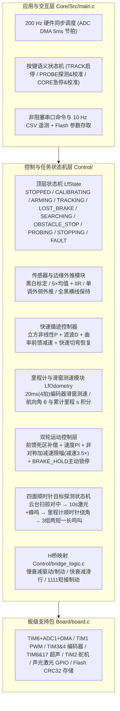

# STM32G474 智能小车固件审查与软件总体架构设计

本设计文档位于软件工程工作区 `docs/software-architecture-and-review.md`，对 [Board/board.c](file:///c:/Users/Seraphina/Documents/ESD/firmware/line-following-car/Board/board.c)、[Control/line_follower.c](file:///c:/Users/Seraphina/Documents/ESD/firmware/line-following-car/Control/line_follower.c)、[Control/bridge_logic.c](file:///c:/Users/Seraphina/Documents/ESD/firmware/line-following-car/Control/bridge_logic.c) 及 [Core/Src/main.c](file:///c:/Users/Seraphina/Documents/ESD/firmware/line-following-car/Core/Src/main.c) 进行全面审查，并给出面向全流程任务（快速循迹竞速、`<15cm` 超声主动制动停车、声光提示、四面顺时针激光打靶、掉电校准保存）的软件总体架构与算法优化方案。

---

## 1. 硬件网表与片上外设审查（已核对嘉立创EDA主扩展板网表与CubeMX数据库）

基于主扩展板实时导出网表 [live-main-netlist.json](file:///c:/Users/Seraphina/Documents/ESD/firmware/line-following-car/docs/live-main-netlist.json)、[hardware-relevant-parts.json](file:///c:/Users/Seraphina/Documents/ESD/firmware/line-following-car/docs/hardware-relevant-parts.json) 与本机 STM32CubeMX `GPIO-STM32G47x_gpio_v1_0_Modes.xml` 逐脚核对，确认全车硬件接口与定时器资源分配如下（完整引脚表见 [board-pin-map.csv](file:///c:/Users/Seraphina/Documents/ESD/firmware/line-following-car/docs/board-pin-map.csv)）：

### 1.1 致命硬件配置修复（P0）

| 编号 | 问题位置 | 根因分析 | 修复状态 |
| --- | --- | --- | --- |
| **P0-1** | `Board/board.c` `pwm_init()` | 原代码将 `PE9/PE11/PE13/PE14` 配置为 `GPIO_AF6_TIM1`。在 STM32G474 上，`PE9/PE11/PE13` 的 `AF6` 无定义，而 `PE14` 的 `AF6` 是 `TIM1_BKIN2`（刹车输入），会导致四路 H 桥均无 PWM 输出且右桥 `BIN2` 悬空。 | **已修复为 `GPIO_AF2_TIM1`**，同步更新 [board-pin-map.csv](file:///c:/Users/Seraphina/Documents/ESD/firmware/line-following-car/docs/board-pin-map.csv) 与 [README.md](file:///c:/Users/Seraphina/Documents/ESD/firmware/line-following-car/README.md)。 |

### 1.2 全车定时器与 DMA 零冲突资源矩阵（解决 P1-2 定时器冲突）

原工程将 `TIM2` 用作 ADC 1 kHz 触发源，但硬件上舵机引脚 `PA15` (`MCU_SERVO_PWM`) 仅支持 `TIM2_CH1 (AF1)` 或 `TIM8_CH1 (AF2)`，而 `TIM8_CH1` 已被超声回波 `PC6` 占用。重构后将 ADC 触发迁移至基本定时器 **`TIM6`**，彻底释放 `TIM2` 供舵机使用，并用 **`TIM17`** 单脉冲硬件生成 `45 µs` 超声触发脉冲、**`TIM8`** PWM 输入捕获模式硬件测量回波脉宽（零 CPU 阻塞、零中断抖动）：

| 外设 | 时钟/分频 | 引脚与复用 (AF) | 用途与硬件机制 |
| --- | --- | --- | --- |
| **TIM1** | 80 MHz, ARR=3999 (20 kHz) | `PE9/11/13/14` (**`AF2`**) | 双 H 桥四路 PWM（`UDIS` 同步预装载更新，支持慢衰减驱动/制动与 20 ms 换向互锁） |
| **TIM2** | 80 MHz / 80 = 1 MHz, ARR=19999 (50 Hz) | `PA15` (**`AF1`**) + `PC7` (EN) | 水平云台舵机 PWM（`1 µs` 分辨率，`500..2500 µs`；开电源 `PC7` 后延时 `5 ms` 再发波防倒灌） |
| **TIM3** | 80 MHz, ARR=65535 | `PA6/PA7` (**`AF2`**) | 右轮正交编码器四倍频计数（`IC1F=IC2F=6` 数字滤波，主板已镜像换相） |
| **TIM4** | 80 MHz, ARR=65535 | `PB6/PB7` (**`AF2`**) | 左轮正交编码器四倍频计数（启动前先关 `UCPD` 死电下拉） |
| **TIM6** | 80 MHz / 80 = 1 MHz, ARR=999 (1 kHz) | 内部 `TRGO_UPDATE` | **1 kHz 主采样基准**：硬件触发 `ADC1` 四通道扫描 |
| **ADC1 + DMA1_Ch1** | 20 MHz 异步时钟，`247.5` 周期采样 | `PA0..PA3` (`IN1..4`) | **双缓冲 5 采样硬件块均值**：每 `5 ms`（`200 Hz`）完成 5 组×4 通道转换，DMA 半满/全满中断对每路 5 次采样求均值并置位 `200 Hz` 控制节拍标志 |
| **TIM8** | 80 MHz / 80 = 1 MHz, ARR=65535 | `PC6` (**`AF4`**, `TIM8_CH1`) | **超声 `ECHO` 硬件 PWM 输入捕获**：`TI1FP1` 上升沿硬件清零 `CNT`，`TI1FP2` 下降沿硬件锁存高电平脉宽（`1 µs` 分辨率）至 `CCR2`，零中断开销 |
| **TIM17** | 80 MHz / 80 = 1 MHz, OPM 单脉冲 | `PB9` (**`AF1`**, `TIM17_CH1`) | **超声 `TRIG` 硬件单脉冲发生器**：写 `CR1.CEN` 自动输出精确 `45 µs` 正脉冲并自动停机 |
| **SPI1** | 预留 `PB3/PB5` (`AF5`) + `PD10..13` | `J_LCD` | 1.8 寸 `ST7735S` 彩屏接口（非阻塞分块刷新预留） |
| **USART1** | 115200 8N1, 环形缓冲 | `PA9/PA10` (**`AF7`**) + `PA8/PC10` | `HC-04` 蓝牙无线遥测与在线调参控制台 |

---

## 2. 软件分层总体架构（解决 P1-1 / P1-3 / P1-4 / P1-5）

### 2.1 核心架构改进点

1. **硬件同步 200 Hz 控制节拍 + 5× 过采样均值（解决 P1-3、P2-5）**
   - `TIM6` 以 `1 kHz` 触发 `ADC1` 扫描四路红外，`DMA1_Channel1` 循环缓冲区设为 `40` 个半字（前 20 半字 = 5 次扫描，后 20 半字 = 5 次扫描）。
   - 每 `5 ms`（`200 Hz`）触发一次 DMA 半传输或全传输完成回调，在回调内将每个通道的 **5 次连续采样求平均**，消除开关电源与环境光高频毛刺，并推进硬件节拍计数。
2. **掉电非易失性 Flash 参数与校准存储（解决 P2-7 及正式测评换板痛点）**
   - 正式测评要求“断电安装 G474 核心板 → 上电 → 单击循迹键 2s 启动”。若校准值仅存于 RAM，断电插板后单击循迹键会因未校准直接拒动。
   - 新增 `board_flash_save()` / `board_flash_load()`，占用 512 KB Flash 顶部页（`0x0807F800`，链接脚本 `STM32G474VETX_FLASH.ld` 预留顶部 4 KB），带 Magic、版本号与 CRC-32 校验。
   - 每次完成 `cal`、`calset` 或执行 `save` 命令时自动写入 Flash；上电初始化时自动加载有效校准值与调参配置，实现**上电即按 `TRACK` 键直接发车**。
3. **按键语义与全任务衔接（解决 P1-4）**
   - `KEY_TRACK` (`PD0`)：在 `STOPPED` 下单击 → 延时 2s 启动循迹；运行中单击 → 主动制动停止。
   - `KEY_PROBE` (`PD1`)：
     - 在 `OBSTACLE_STOP`（遇到 `<15cm` 障碍物自动停车后）单击 → **立即启动 3 分钟四面顺时针目标探测（`LF_PROBING`）**，严格匹配任务书 §1.1(4) 与 §5.2(3)！
     - 在 `STOPPED` 下长按 1s → 启动 8s 传感器黑白校准（自动存入 Flash）。
   - `KEY_CORE` (`PD15`)：任意时刻单击 → 安全停止/清故障；在 `STOPPED` 下长按 1s → 也可触发 8s 校准。
4. **主动电枢短接制动保持 `BRAKE_HOLD`（解决 P1-5）**
   - 遇到 `<15cm` 障碍物进入 `LF_OBSTACLE_STOP`、或处于四面打靶 `LF_PROBING` 停止瞄准期间，保持 `enable = true, brake = true`（H 桥输出 `1111` 主动电磁制动），点亮停车灯 `PD8`，蜂鸣器 `PC9` 精确鸣叫 `1.0 s` 后停鸣而保持停车灯常亮，直至按下 `KEY_PROBE`。

---

## 3. 快速软件循迹专项优化设计（解决连续 S 弯与急弯冲线）

结合 [硬件PID弯道失效分析与台架排查.md](file:///C:/Users/Seraphina/Documents/ESD/reviews/2026-11-16-hardware-pid-video/%E7%A1%AC%E4%BB%B6PID%E5%BC%AF%E9%81%93%E5%A4%B1%E6%95%88%E5%88%86%E6%9E%90%E4%B8%8E%E5%8F%B0%E6%9E%B6%E6%8E%92%E6%9F%A5.md) 中的实车几何（轮距 `b = 130 mm`、前伸 `L ≈ 35 mm`、探头节距 `13 mm` 即横向坐标 `±6.5, ±19.5 mm`、黑胶带宽 `20 mm`），针对原软件循迹算法做出 5 项关键提速优化：

### 3.1 阵列外侧单调位置外推（Outer-Edge Monotonic Extrapolation，解决 P2-2）
- **原问题**：归一化质心 `pos = sum(x_i * q_i) / sum(q_i)` 在黑带滑出到仅最外侧单路（`L2` 或 `R2`）见黑时，无论黑带压在探头正中（`q_outer = 1.0`）还是即将滑出探头外缘（`q_outer = 0.22`），质心恒等于 `±1.0`。导致最危险的脱线边缘处**比例误差饱和不变、微分项 `d(pos)/dt` 归零**！
- **优化算法**：
  - 将默认探头归一化坐标修正为真实几何比例 `{-1.00, -0.35, +0.35, +1.00}`。
  - 当仅最外侧通道有效（内侧通道 `q < 0.08`）且最外侧见黑强度 `q_outer` 从 `0.90` 向 `0.20` 衰减时，根据边缘灰度连续外推位置：
    $$\mathrm{pos}_{\mathrm{extrap}} = \mathrm{sign} \cdot \left(1.0 + 0.60 \cdot \frac{0.90 - q_{\mathrm{outer}}}{0.70}\right) \in [-1.60, +1.60]$$
  - 当黑带完全覆盖外侧探头（`q_outer >= 0.90`）时 `pos = ±1.0`；当黑带继续向外滑出时，`|pos|` 单调递增至 `1.60`，同时产生强有力的同向微分阻尼 `d(pos)/dt`，在脱线前把车头强行拉回！

### 3.2 4 拍（20 ms）编码器滑窗测速 + 低延迟滤波（解决 P2-3）
- **原问题**：`840 counts/rev`、`43 mm` 轮径下，单脉冲分辨率为 `0.1608 mm`。在 `5 ms` 单拍内，1 个脉冲跳变即造成 `32.16 mm/s` 的速度阶跃；原代码为此加了 `30 ms` 一阶低通滤波，导致连续 S 弯换向时轮速反馈滞后达 `30 ms`。
- **优化算法**：维护长度为 4（`20 ms`）的编码器增量滑动窗口，用窗口总脉冲除以窗口时长计算基础轮速，量化噪声直接降低 **4 倍**（降至 `8.04 mm/s`），同时将一阶平滑时间常数从 `30 ms` 缩短至 `6 ms`，使速度环相位滞后缩短 60% 以上。

### 3.3 非线性立方比例增益 `line_k3` + 非对称快速减速限幅（解决连续 S 弯换向迟滞）
- **原问题**：原代码 `acceleration_mm_s2 = 500 mm/s²` 对加速和减速一视同仁。在连续 S 弯中，前一个弯的外轮（如 `220 mm/s`）切换为后一个弯的内轮（`0 mm/s`）需要 **`440 ms`**，期间小车已冲出赛道 `66 mm`！
- **优化算法**：
  1. **非线性比例项**：引入三次方渐进增益 `pos_eff = pos * (1 + k3 * pos²)`（默认 `line_k3 = 0.35`）。直线小偏差（`|pos| < 0.3`）保持柔和不摆头；进入急弯外侧（`|pos| >= 1.0`）自动放大纠偏力矩。
  2. **非对称加减速与占空比斜率**：将默认加速度提升至 `1200 mm/s²`、占空比斜率提升至 `5.0 /s`，且当目标轮速需要**减速或反向**（即成为内轮）时，允许 **3.5 倍减速度**（`4200 mm/s²`），使内外轮快慢互换在 **`30~50 ms`** 内完成！

### 3.4 起终点横线 / 十字交叉口（`ALL_BLACK`）平顺穿越（解决 P1-6）
- 当四路探头同时见黑（`darkness[0..3] >= 0.85`）时：
  - 在 `ambiguous_ms`（默认 `80 ms`，可通过 `set cross_ms` 调大至 `300 ms`）窗口期内，**冻结 `position = last_position` 且令 `derivative = 0`**，避免四路全黑导致质心突变为 0 而引发剧烈的假微分甩尾，使小车保持原姿态平顺穿过横线/交叉口；
  - 仅当持续全黑超过设定阈值时才判定为异常并安全停机。

### 3.5 失线高速旋回重捕获（Fast Pivot Search，解决 P2-1）
- 当急弯外冲进入 `LF_SEARCHING` 时，不再使用固定慢速 `70 mm/s` 爬行，而是根据当前巡航基速 `cruise_mm_s` 自动按比例输出大差速旋回（外轮 `max(85, 0.78 * cruise_mm_s)`，内轮在允许反转时 `-max(45, 0.42 * cruise_mm_s)`、禁止反转时 `0`），并在重新捕获黑线的瞬间将 `last_position` 对齐为当前 `position`，消除重入轨时的微分冲击。

### 3.6 左右轮电机死区与全量程转速 5 轮自动标定（空载 & 地面往返）+ 分段插值前馈
- **原问题**：N20 直流减速电机存在显著的个体差异（静摩擦死区与高占空比斜率均不同）。仅扫到 0.40 占空比无法覆盖 0.50 以上高速工作区；且只在架空测试无法反映轮胎滚动阻力。
- **优化方案**：
  1. **覆盖全量程的 15 档占空比 (`0.06 ~ 0.95`)**：`max_duty` 默认提升至 `0.95`，标定阶梯扩展为 `{0.06, 0.09, 0.12, 0.15, 0.18, 0.21, 0.24, 0.30, 0.38, 0.46, 0.55, 0.65, 0.75, 0.85, 0.95}`（低速 3% 细步长测起转死区，中高占空比覆盖至 95%）。
  2. **双模式 × 5 轮均测满 15 档**：支持 **`mcal air 5`**（架空空载 5 轮 × 15 档）与 **`mcal ground 5`**（地面带载 5 轮 × 15 档：每步脉冲后主动刹车 80 ms 控制单步位移，每轮结束后依靠编码器里程计带航向纠偏自动倒车回到原点，配合 `<18cm` 超声防撞）。
  3. **15 点分段插值前馈 (`lf_wheel_feedforward`)**：`speed_control()` 优先在 15 点实测曲线上做分段线性反插值并叠加左右独立死区/满速斜率，做到“想让轮子转多快、不靠 PI 就能直接跑到对应转速附近”，支持 `vtest VL VR MS` 一键验证。
  4. **Agent 优先的蓝牙上位机归档（RAM-first，免写 Flash）**：上位机 [tools/host_station.py](file:///c:/Users/Seraphina/Documents/ESD/firmware/line-following-car/tools/host_station.py) 提供无界面 CLI 自动收发 JSON 接口与可视化 GUI，批量采集保存至 `data/` 目录；待实地采到赛道红外数据后，再依据实测波形评估硬件模拟 PID 电路（`R39/R40`、`R41/R42`、`RV_V`、`JP_V 2-3`、`R60`、`RV_P`、`RV_D`）。

---

## 4. 配套工程文档索引

- 代码全景说明（供全组同学快速读懂全部代码）：[docs/codebase-guide.md](file:///c:/Users/Seraphina/Documents/ESD/firmware/line-following-car/docs/codebase-guide.md)
- 硬件开发板与 MCU 引脚逐脚对接详单：[docs/hardware-interface-manual.md](file:///c:/Users/Seraphina/Documents/ESD/firmware/line-following-car/docs/hardware-interface-manual.md)
- 引脚速查 CSV 表：[docs/board-pin-map.csv](file:///c:/Users/Seraphina/Documents/ESD/firmware/line-following-car/docs/board-pin-map.csv)
- 实车操作、ST-LINK 下载/调试与 VS Code `Serial Monitor` 蓝牙调参手册：[README.md](file:///c:/Users/Seraphina/Documents/ESD/firmware/line-following-car/README.md)
