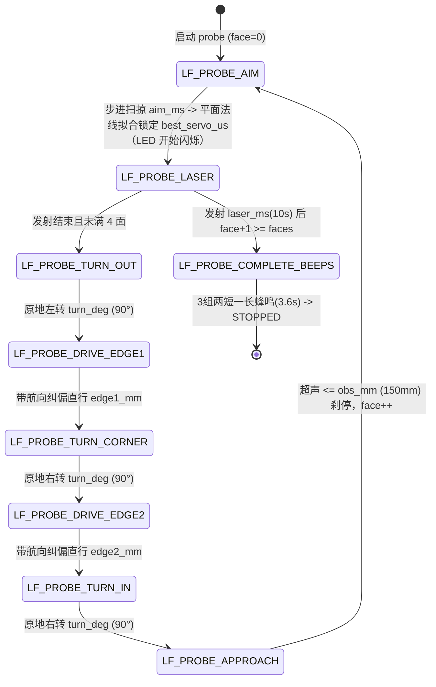

# 队友交接指南：全软件任务架构与四面激光打靶（蓝牙标定/录数）开发手册

> **交接背景**：纯硬件模拟电路循迹已改板实车跑通（详见 [pure-analog-rework-and-calibration.md](pure-analog-rework-and-calibration.md)），软件闭环循迹与电机死区/前馈标定均已完成并归档。  
> **当前版本**：已完成**全部软件任务的主体状态机框架与蓝牙标定/采集工具链**，插上 STM32G474 核心板即可直接开展**提高部分（2）四面顺时针目标探测与 10 秒激光打靶**的实车标定与优化。

## 最新改动（2026-11-25）：首面后行程缩至 85% + 第二面异常宽度不再回旧原点

**已烧录复跑，用户现场反馈“这次相当好”；量化日志待补。** 上一轮 `DRIVE1=258 mm` 后，第二面实测 `h=205 mm`、期望 `h_ref=153 mm`，说明绕角后站位偏远。现把第一段越角行程 `L1` 统一乘 **0.85**（`LF_LEG_L1_SCALE`），只缩 `L1` 不缩 `L2`：`L1` 决定绕角后与下一面的站位，`L2` 只决定沿下一面的展开位置。

同时修掉上一轮 `w=12.3 → 回旧原点 0 → edges=0 → 13.4 s 超时` 的链路：

- 两边界与中点仍合理、只是 `w` 公式失配时（窄面原始跨度约 66 mm 的典型情况），不再判成整遍扫描无效；照常先开到 `face.s_m` 做复测，`side_warn=14`。
- 即使进入异常重扫分支，也优先回到初扫中点 `probe_side_retry_target()`，不再回旧原点。
- 面内证据不足时不再因候选外点刹车，避免“停住后 `side_inface` 永远补不到 10 帧”的确认死锁。
- 回归测试新增 `h=205、原始边 +62.6/−3.7、s_m=29.5` 场景，并更新 LEG 的 0.85 比例断言。
- 当前 Host 单测 **38/38**、Debug/Release 固件构建零告警、`host_station.py --selftest` 通过；已烧录，现场反馈良好。
- 完整修复记录、证据链和复跑观察点见 **[M4g-l1-and-narrow-retry-20261125.md](M4g-l1-and-narrow-retry-20261125.md)**。

宽面最终停车补偿仍为沿扫描轴朝车头 **+20 mm**，用户已实测稳定得 **6 分**。窄面宽 **50 mm**，三等分计 **2 / 4 / 2 分**，中间 4 分区为几何中心左右各约 **8.3 mm**。宽面补偿只施加在最后一次回中的停车目标上，窄面按超声扫出的中点停车。 [宽面补偿定义](../Control/line_follower.h)

### 复跑重点

1. 看 `PROBE_LEG,seg=DRIVE1,len=...,raw=...,k=0.85`：上一轮 `raw=258.0`，本轮应约 **219.3 mm**。
2. 看第二面 `PROBE_SIDE_LOCK,h=...`：若从 205 mm 降到 **160~175 mm**，说明 85% 方向正确；若低于约 100 mm 或转角擦箱，回调 `LF_LEG_L1_SCALE`。
3. 看 `PROBE_SIDE_MID,warn=14` 后是否进入 `SIDE_MOVE → VERIFY → LASER`，以及 `PROBE_SIDE_FAIL` 是否消失。
4. 量首次光斑到窄面中心线的水平距离；窄面只有 50 mm，85% 的落点修正仍需现场闭环。

---

## 失败复盘（2026-11-25 12:30）：第二面面宽判失败，重扫后停车

**该问题已按上面的改动修复并通过本地回归，待实车复跑。** 上一轮蓝牙实跑确认了失败路径：`DRIVE1=258 mm` 后第二面 `h=205 mm`，窄面初扫得到 `w=12.3`，旧逻辑回扫描原点 `0` 重扫，最终 `edges=0` 超时。旧版重扫策略已替换。宽面最终停车补偿为沿扫描轴朝车头 **+20 mm**，用户已实测稳定得 **6 分**。窄面宽 **50 mm**，三等分计 **2 / 4 / 2 分**，中间 4 分区为几何中心左右各约 **8.3 mm**。宽面补偿只施加在最后一次回中的停车目标上，窄面按超声扫出的中点停车。 [宽面补偿定义](../Control/line_follower.h)

### 当前固件和调试条件

- MCU 为 **STM32G474VET6**，通过 **HC-04 / COM3 / 115200** 联调。此次 Windows 重现串口后连接成功。运行前 `STATE=STOPPED FAULT=OK MCAL=0(DEFAULT)`，为复现现场状态沿用默认电机参数。运行时临时设为 **2 面**，保持 **10 秒发射、侧扫复测开启**。结束后已恢复 `probe_faces=4`，读取状态为 `STOPPED / FAULT=OK`。
- 首面转平行后，使用 AIM 回波估计的箱面位置和编码器记录的实际航向来选择正式起扫方向。`PROBE_SIDE_SEEK,dir=...` 记录找面方向，`PROBE_SIDE_LOCK,...,first=FWD/REV` 记录正式扫第一条边的方向。本次首面和第二面日志均为 `first=FWD`，本地测试另覆盖了首次直接反扫并找到两条边的情况。
- 边界坐标取超声触发时的编码器扫描轴位置。反扫具备提前减速、制动和快判。反扫在第二条边形成超过 **15 mm** 的夹区时，可沿反方向低速回探，最多每 **30 mm** 停车采样，回探行程上限 **75 mm**、时间上限 **2.5 秒**。`PROBE_SIDE_REFINE,used=1` 表示采用了回探边界。最近一次固件 Debug 编译和 **38 项本地测试**通过。蓝牙复跑期间没有烧录或改固件。 [控制代码](../Control/line_follower.c) · [回归测试](../tests/test_controller.c)

### 蓝牙实跑证据

原始日志为本机采集文件 [second_face_bt_20261125_123050.log](../data/bench/second_face_bt_20261125_123050.log)，按仓库规则不随 Git 同步。关键证据见下表。面号从 0 开始，第二面对应 `face=1`。

| 阶段 | 本轮记录 |
| --- | --- |
| 首面 | 复测宽 **153.5 mm**，进入发射并转入第二面 `LEG`。 |
| 绕向第二面 | 转向 `cmd=90.0`、`ach=90.4`，`DRIVE2` 以 `stop=E` 正常结束。 |
| 第二面侧锁 | `h=205.0`、`pred=153.0`、`ok=1`，进入 `SIDE_SCAN`。 |
| 第二面初扫 | 两条回波边界为 **+62.6 mm** 和 **−3.7 mm**，原始间距约 **66.3 mm**。当前两侧共扣约 **54 mm** 的波束补偿，得到 `w=12.3`、`s_m=29.5`。 |
| 重扫与停车 | `w=12.3` 低于固件的 **15 mm** 门限，程序回到旧扫描原点 `side_target=0` 重扫。约 **13.4 秒**后报 `PROBE_SIDE_FAIL,lock_stage=6,edges=0,retry=1,h=205.0`，随后 `STOPPED OK`。 |

### 当时的下一步（已完成/待实车验证）

1. ✅ 已修改 `LF_PROBE_SIDE_SCAN`：两边界/中点合理时先开到 `face.s_m`；异常重扫也优先回初扫中点，不再回旧原点。 [异常宽度与重扫分支](../Control/line_follower.c)
2. ✅ 已加原始跨度约 **66 mm**、补偿宽 **12.3 mm**、粗中点 **+29.5 mm** 的回归场景；另加了“原始跨度也不可信时仍优先回中点”的断言。
3. ⏳ 仍需用有刻度的窄面台架复测 `2h·tanγ`。这次先按现场判断把 `L1` 缩到 **85%**，复跑后同时记录下一面 `h`、`warn=14` 与首次光斑偏距，再决定是继续调 `L1` 还是回调窄面足印补偿。

---

## 历史记录（2026-11-25 10:39）：首面倒车扫程仍过大

### 用户确认的问题

- MCU：STM32G474VET6；蓝牙 HC-04 串口为 COM3。
- 用户明确：当前剩余问题是**反向（倒车）扫描/行程过大**，不是激光线的问题。
- 用户在本轮测试后复位了小车。不要仅凭 `STATE=STOPPED` 认定已经完成整面；本轮日志只确认进入过 `LASER`，没有完整的 `STOPPED OK` 收尾记录。

### 本轮固件与复跑

- 在 `Control/line_follower.c` 的偏航修正分支中，已把修正后的重扫起点从旧扫描原点改为首扫估计的靶心 `face.s_m`；目的是让后续重扫更居中。Debug 构建成功，STM32CubeProgrammer 在烧录前曾报告未检测到探针；随后用户明确告知已烧录。
- 烧录后通过 HC-04 下发了 GROUND 电机标定，开跑前状态确认 `MCAL=1(GROUND)`。用户复位后 RAM 标定会丢失，下一次运行前需重新执行 `python tools/host_station.py push --port COM3 --mode GROUND`。
- 本轮参数：`m4e_full_run.py COM3 1 10000 1 120`（1 面、激光 10 s、侧扫复测开启）。日志：[m4e_full_20261125_103936_f1.log](../data/bench/m4e_full_20261125_103936_f1.log)。

### 关键数据

- AIM 有效：`phi=18.96,rho=148.6,rms=12.1,hits=15`；TURN_PAR 后航向约 `-72.32°`。
- 首扫边界：正向 `s=+143.0`，反向 `s=-58.5`，中点 `s_m=42.3 mm`。扫描起点偏离面中心约 42 mm，因此第一次反扫从正向边界穿过起点继续扫到另一条边，路径天然长于正向单程。
- 偏航修正后，代码按 `face.s_m` 移动；随后重扫事件记录 `distance=35.6 mm`。重扫中点为 `14.3 mm`，复测中点为 `15.9 mm`；流程进入过 `LASER`（`PROBE_EVENT,148892,...,LASER`）。用户仍观察到倒车过大，所以这次逻辑调整**没有解决用户所见问题**，需要继续定位实际倒车段。
- 反向边界回波过渡明显比正向宽：一次反向边日志 `last_in=-55.3,first_out=-99.0`，相差约 `43.7 mm`；对应边界被记为 `s=-77.1`。同一遍正向边 `last_in=138.7,first_out=147.4`，相差约 `8.7 mm`。这是反向距离偏大的重要线索：强跳变判据前的中间回波阶段可能让车继续移动，之后才触发停车/边界确认。

### 下一步重点

1. 先从该日志确认用户所说的“倒车过大”对应哪段：`SIDE_SCAN` 的 REV 跨面扫边、偏航修正后的 `SIDE_MOVE`，还是复测后的最终开位；不要把 `PROBE_EVENT` 的累计 `distance_mm` 直接当作侧扫局部坐标 `s`。
2. 检查 `probe_side_feed()`：当前只有强跳变/无回波外点才置 `side_edge_pending` 并刹车；回波偏离 `side_band_mm` 但尚未满足 `side_jump_mm` 时会继续行驶。结合反向 `last_in` 到 `first_out` 的 43.7 mm 间隔，评估反向渐变回波是否导致延迟停车和边界偏差。
3. 不要凭空给反向行程乘比例系数。若增加反向专用停止/确认策略，应保留“模糊回波不误判为边界”的约束，并在蓝牙日志中记录停止前后的局部 `s`、方向、候选/确认回波位置。
4. 本轮主机采集脚本没有及时因 `STOPPED OK` 自动退出；中断后通过 HC-04 发送 `stop`，状态返回 `STATE=STOPPED FAULT=OK`。`m4e_full_run.py` 的完成事件检查只看 `lines[-15:]`，后续可修为持久完成标志，避免结束行被 10 Hz 遥测挤出窗口。

---

## 零、2026-11-22 进展补记（先读这段）

> 本文件正文写于 M1 之前，描述的是「8 阶段矩形绕行」框架（即 M1 过渡流程，`probe_scan_mode=0` 时仍可用）。
> 现在的实现已按**侧视横扫（模式 B）**重构；**当前参数默认值、日志格式、状态机以 [接口契约_M1.md](../../接口契约_M1.md)、[手册_M1-M5实施步骤.md](../../手册_M1-M5实施步骤.md) 为准**。

| 里程碑 | 状态 | 关键内容 |
| --- | --- | --- |
| M1 | ✅ 已烧录并台架验证 | 两段式 AIM（粗扫 ±30°/10 点 + 细扫 ±12°/10 点）输出 `face.phi/rho/rms/hits`；`PROBE_FACE` 日志 |
| M2 | ✅ 已烧录 + 4 次台架全流程验证 | 侧视横扫 `SIDE_LOCK → SIDE_SCAN → SIDE_MOVE(+VERIFY) → LASER`；台架命令 `side` / `side push`；11 个 `probe_side_*` 参数；**M2 阶段自动流程保持 M1**（AIM→正面 LASER），**M3 已接入** `AIM→TURN_PAR→SIDE_LOCK` |
| M3 | ✅ 代码+单测，宽→窄台架通过；⏳ Gate 0 | `TURN_PAR` 接在 AIM 后；`LEG` = DRIVE1→TURN→DRIVE2（**无 ALIGN**），宽→窄下一面 `h=215 ok=1`、`w=43.6 NARROW`、`TURN 90/91` 实车左转；`BOARD_SWAP_LR=0`、`track_mm=112.5`。**2026-11-23 实车通过 G0-2（TURN_PAR `-90.4/-91.0`）与 G0-4（faces=2 自动，面2 `w=65.9 NARROW`）**；G0-3 窄→宽待跑。详见 **[M3-task-handover.md](M3-task-handover.md)** |
| M4 | 🚧 Gate 0 进行中（G0-2/G0-4 已过，G0-3 待跑） | 已落地：LEG 侧距连续采样、沿面 60 mm 平移测斜、`seg=BACKUP`、宽窄判据 100、锁定容差 70；计划：四面循环、回 AIM 重试、h_pred/pred 跨面、`probetour`、参数/Flash 8。见 [M4计划_评审与修订.md](../../M4计划_评审与修订.md) 与 [M4-gate0-20261123.md](M4-gate0-20261123.md) |
| M4f | ✅ 已烧录（2026-11-24 20:31） | AIM 改 **0~180° 全行程 + 角域边界法**（φ/宽度由两条棱边决定，TLS 主轴 + γ 补偿）；**二次微调重新启用、死区 1°**；**打靶精度仍未解决** → 见下方 ⚠ 与 [M4f-aim-boundary-20261124.md](M4f-aim-boundary-20261124.md) |
| M5 | ⏳ | 参数冻结、`probe_dry_run`、报告与日志归档 |

> ⚠ **当前未解决（2026-11-24 交接重点）**：四面全流程能跑通（145.7 s、四面 `SIDE_LOCK ok=1 warn=0`），
> 但**光斑稳定偏向小车后方**，宽面五等分（30 mm/带，2/4/6/4/2）时得分只有 **2~4 分**。
> 已排除：e≈0（激光与超声装在一起）、中点算错（两遍独立扫描只差 9.1 mm）、停车不可复现（±10 mm）、点数太少。
> 唯一剩下的候选：**激光与声波轴线有固定夹角 α**（光斑偏移 = `h·tanα`，h 四面相近 → 表现为常数、同侧）。
> 判定方法（10 分钟、不驱动电机）与一行修法见 [M4f-aim-boundary-20261124.md](M4f-aim-boundary-20261124.md) §6。

### 新增 / 变更的命令

| 命令 | 作用 |
| --- | --- |
| `side` / `side push` | M2 台架侧扫：自走 / 电机断电、人工沿面推车（跳过 AIM，直接 SIDE_LOCK） |
| `leg` | M3 台架单段绕行：直接用当前 side 的 w/h 跑 DRIVE1→TURN→DRIVE2；**不要再先 `side`**，否则面序锁存重置 |
| `turn DEG [SPD]` / `drive MM [SPD]` | 单段转向/直行标定；`turn +` = 左转（要求 `BOARD_SWAP_LR=0`） |
| `set probe_scan_mode 0/1` | 0 = M1 过渡流程（AIM→正面 LASER）；1 = 侧视（默认；**M3 起自动流程 `AIM→TURN_PAR→SIDE_LOCK`，不再保持 M1**） |
| `set probe_side_us/left/spd_mm_s/reach_mm/band_mm/jump_mm/verify` | 侧扫参数（默认 2400 / 1 / 50 / 260 / 15 / 40 / 1） |
| `set probe_beam_half_deg` / `probe_pan_x_mm` / `probe_fit_rms_mm` | γ=7.5°（只影响宽度）/ 云台前移 30 mm / 面拟合 rms 门限 15 mm |
| 新日志 | `PROBE_MODE`、`PROBE_SIDE_LOCK`、`PROBE_SIDE_EDGE`、`PROBE_SIDE_MID`、`PROBE_SIDE_FAIL`、`PROBE_SIDE_CFG`（格式见契约 §4） |

> **下文旧表已过时**（M1 之前冻结的默认值）：`probe_sweep_us` 600→**300**（粗扫半幅；单面测试编译开关会覆盖成 600）、`probe_step_us` 75→**60**、舵机行程→**600~2400 µs**、`probe_side_band_mm`=**15**、`probe_side_jump_mm`=**40**。


## 一、全部软件任务总览与当前就绪状态

| 软件任务模块 | 核心状态机 / 触发方式 | 当前状态 | 关键代码位置 |
| :--- | :--- | :---: | :--- |
| **1. 软件高速循迹** | `LF_CALIBRATING` -> `LF_ARMING (2s)` -> `LF_TRACKING`（按 `SW2` 或蓝牙 `start`） | ✅ 已跑通（后续可继续提速优化） | [Control/line_follower.c](../Control/line_follower.c) |
| **2. 超声波 `<15cm` 避障刹停** | 循迹中超声连续命中 `<= 150 mm` -> `LF_OBSTACLE_STOP`（主动短接制动 + 停车灯常亮 + 1s 长鸣；行驶期间舵机锁中位保证测距朝前） | ✅ 已集成并过单测 | [Control/line_follower.c](../Control/line_follower.c) |
| **3. 停车后自动寻找“垂直位置”** | `LF_OBSTACLE_STOP` 后 300 ms 自动进入 `LF_PROBING/AIM`：舵机步进扫掠 + `1/r=a·cosθ+b·sinθ` 最小二乘拟合求平面法线，锁定角度后核心板 LED 150 ms 周期闪烁 | ✅ 已实现并新增 `probeaim` 精度单测 | `step_probing()` / 模块 8a `probe_fit_normal()` |
| **4. 四面顺时针目标探测与 10s 打靶** | 在 `LF_OBSTACLE_STOP` 或 `LF_STOPPED` 下按 `SW3` 或蓝牙 `probe` -> `LF_PROBING`（8 阶段矩形绕行 + 3 组两短一长结束提示） | ✅ **完整可调框架已就绪，待实车标定几何/云台参数** | [Control/line_follower.c](../Control/line_follower.c#L807-L925) |
| **5. 蓝牙串口数据采集与在线标定** | `host_station.py`：`mcal` / `push` / `capture` / **`probe-scan`** / **`probe-odom`** / **`probe-run`** | ✅ **已全部打通并过自检** | [tools/host_station.py](../tools/host_station.py) |

---

## 二、四面打靶 (`LF_PROBING`) 8 阶段状态机架构

为了让小车可靠绕过方形/柱状障碍物四面，固件实现了完整的 **8 阶段矩形绕行状态机**（所有角度、距离、速度、时长均支持蓝牙实时调节，无需反复烧录）：



### 全部可调参数表（蓝牙 `set <参数名> <数值>`）

| 蓝牙参数名 | 结构体字段 (`LfProbeConfig`) | 默认值 | 合法范围 | 物理含义与现场调参说明 |
| :--- | :--- | :---: | :---: | :--- |
| **`servo_us`** | `cfg.servo_center_us` | `1500` | `900..2100` | 云台舵机正对正前方的机械中位脉宽 ($\mu\text{s}$) |
| **`obs_mm`** | `cfg.obstacle_stop_mm` | `150` | `50..500` | 避障停机与打靶逼近刹停的超声距离阈值 ($\text{mm}$) |
| **`probe_cw`** | `probe.clockwise` | `1` | `0` / `1` | `1` = 顺时针绕行四面（任务书要求），`0` = 逆时针 |
| **`probe_faces`** | `probe.faces` | `4` | `1..4` | 目标平面总数；**初期调试建议先设为 `1` 或 `2`** |
| **`probe_aim_ms`** | `probe.aim_ms` | `2000` | `200..5000` | 单面瞄准总时长 ($\text{ms}$，含前 150 ms 归起点稳定，其余时间均分为离散扫描点) |
| **`probe_sweep_us`** | `probe.sweep_us` | `600` | `20..600` | 相对中位的单侧扫掠半幅 ($\pm\text{us}$，默认覆盖满量程 $900..2100\ \mu s$) |
| **`probe_step_us`** | `probe.scan_step_us` | `75` | `20..200` | 步进扫掠相邻采样点脉宽间隔 ($\text{us}$)；越小角度越密，单点驻留时间越短（自动保证 $\ge 60$ ms） |
| **`probe_laser_ms`** | `probe.laser_ms` | `10000` | `200..30000` | 单面激光+蜂鸣器同步发射时长；**联调时可先设为 `2000` 省时间** |
| **`probe_turn_deg`** | `probe.turn_deg` | `90.0` | `30..180` | 每次 90° 原地转向的目标角度；若地面打滑偏少可微调至 `92~96` |
| **`probe_edge1_mm`** | `probe.edge1_mm` | `220.0` | `30..1500` | 阶段 4：离面越过拐角的直行距离（约 $\frac{W}{2} + D$） |
| **`probe_edge2_mm`** | `probe.edge2_mm` | `220.0` | `30..1500` | 阶段 6：沿侧面走至下一面中心垂线的直行距离（约 $\frac{L}{2} + D$） |
| **`probe_approach_mm`** | `probe.approach_max_mm` | `260.0` | `30..1000` | 阶段 8：逼近下一面的最大前移安全距离（防止超声漏检一直往前开） |
| **`probe_turn_spd`** | `probe.turn_speed_mm_s` | `90.0` | `20..300` | 原地转向时的单轮线速度 ($\text{mm/s}$) |
| **`probe_drive_spd`** | `probe.drive_speed_mm_s` | `120.0` | `20..400` | 绕边直行时的目标线速度 ($\text{mm/s}$) |
| **`probe_approach_spd`** | `probe.approach_speed_mm_s` | `85.0` | `20..300` | 逼近下一平面时的缓慢线速度 ($\text{mm/s}$) |

---

## 三、蓝牙串口标定与实车联调标准 5 步流程

> ⚠️ **注意**：本固件采用 **RAM-first** 策略（不自动写 Flash 保护芯片寿命），每次单片机断电重启后，请先执行一次 `push` 将电脑保存的地面电机死区曲线下发至小车 RAM。

### 第 1 步：确认蓝牙连接与硬件外设自检
```powershell
# 1. 查看并绑定默认蓝牙端口（如 COM10）
python tools/host_station.py ports
python tools/host_station.py set-port COM10

# 2. 查看按键、编码器、超声与供电状态
python tools/host_station.py cmd "io" "us"

# 3. 逐项点亮外设自检（安全不转电机）
python tools/host_station.py cmd "outtest lamp 1 1000"
python tools/host_station.py cmd "outtest buz 1 800"
python tools/host_station.py cmd "outtest laser 1 1500"
python tools/host_station.py cmd "outtest servo 1500 1500"
# 或让舵机连续往返扫掠，直到 Ctrl+C / stop（默认 2 s 一个 900->2100->900 周期）
python tools/servo_sweep.py --port COM3 --period 2000
```

### 第 2 步：下发地面电机前馈曲线（消除左右轮跑偏）
```powershell
# 直接把已标定好的 data/latest_calibration.json 下发至小车 RAM
python tools/host_station.py push --mode GROUND

# （若更换了新电池或电机，可重新跑 5 轮地面带载自动标定）
# python tools/host_station.py mcal --mode ground --passes 5
```

### 第 3 步：蓝牙标定云台机械中位与超声波瞄准曲线（`probe-scan`）
将小车正对障碍物平面中心约 `15 cm` 处停稳，运行：
```powershell
python tools/host_station.py probe-scan --span 240 --step 20 --dwell 140
```
- 上位机会自动录制每一档 `(servo_us, obs_mm)` 到 `data/probe_scan_<时间戳>.csv`，并计算超声距离谷底对应的 **`recommended_servo_center_us`**。
- 若实测机械中位偏离 `1500`（例如 `1540`），立即用 `set servo_us 1540` 修正（稳定后可改写到 `Control/line_follower.c` 默认值中）。

### 第 4 步：蓝牙标定直行距离与原地 90° 转弯精度（`probe-odom`）
```powershell
# 1. 标定直行 300 mm：用尺子量小车实际前行距离，与里程计 actual_mm 对比
python tools/host_station.py probe-odom drive 300 --speed 120 --push

# 2. 标定原地左转 90°（正=左转CCW，负=右转CW）：用量角器核对实际转角
python tools/host_station.py probe-odom turn 90 --speed 90 --push
python tools/host_station.py probe-odom turn -90 --speed 90 --push
```
- **标定修正公式**：
  - 若实测转角偏小（如只转了 `85°`）：可增大轮距 `set track_mm <原值 * 90 / 85>` 或直接调大 `set probe_turn_deg 95`。
  - 若实测直行距离偏短（如只走了 `285 mm`）：可减小轮径 `set wheel_mm <原值 * 285 / 300>`。

### 第 5 步：蓝牙一键试跑打靶任务并全程录制 `PROBE` 遥测（`probe-run`）
```powershell
# 1. 先用单面 + 2秒激光 快速验证瞄准与激光发射
python tools/host_station.py probe-run --push --faces 1 --laser-ms 2000

# 2. 验证 4 面完整绕行轨迹（先用 2秒激光 省时间，标定好 edge1/edge2/turn-deg）
python tools/host_station.py probe-run --push --faces 4 --laser-ms 2000 --edge1 220 --edge2 220 --turn-deg 90

# 3. 正式全流程 4 面 × 10 秒打靶 + 3组两短一长验收（全程录数至 data/probe_run_*.csv）
python tools/host_station.py probe-run --push --faces 4 --laser-ms 10000 --edge1 220 --edge2 220 --turn-deg 90
```

---

## 四、编译、单测与烧录命令速查

所有构建均封装在 [tools/build.ps1](../tools/build.ps1) 中：

```powershell
# 编译 Debug / Release STM32G474 固件
.\tools\build.ps1 -Configuration Debug
.\tools\build.ps1 -Configuration Release

# 编译并烧录至 STM32G474（ST-LINK 必须插在主扩展板边缘 J_SWD 座！）
.\tools\build.ps1 -Configuration Debug -Flash

# 运行全部 27 项 PC 主机端单元测试（每次改完 Control/line_follower.c 必跑！）
.\tools\build.ps1 -Test

# 运行蓝牙上位机算法与协议自检
python tools/host_station.py --selftest
```

---

## 五、二次开发与算法优化入口指引

1. **打靶瞄准算法（已完成：步进扫掠 + 平面法线最小二乘拟合）**：
   - 实现见 [Control/line_follower.c](../Control/line_follower.c) 模块 8a：`probe_scan_plan()` 规划离散角度点、`case LF_PROBE_AIM` 逐点驻留采样、`probe_fit_normal()` 对 `1/r = a·cosθ + b·sinθ` 做最小二乘并输出法线方向（残差 >12% 时自动退回三点平滑最小值）。
   - 现场若发现扫掠角度覆盖不足，用 `set probe_sweep_us 600` / `set probe_step_us 50` / `set probe_aim_ms 2400` 在线调整；瞄准结果由 `PROBE_LOCK,face=,servo_us=,angle_deg=,dist_mm=,points=` 回传。
2. **改进绕障路径（如边走边用超声测角、动态识别障碍物宽度）**：
   - 修改 [Control/line_follower.c](../Control/line_follower.c) 中的 `LF_PROBE_DRIVE_EDGE1` / `LF_PROBE_DRIVE_EDGE2` / `LF_PROBE_APPROACH`。
3. **固化现场标定好的默认参数**：
   - 调出最优参数后，直接写回 [Control/line_follower.c](../Control/line_follower.c) 的 `lf_default_config()`，重新编译烧录即可断电永久保存。
4. **硬件接口逐脚定义与排错**：
   - 详见 [docs/hardware-interface-manual.md](hardware-interface-manual.md) 与 [docs/codebase-guide.md](codebase-guide.md)。
