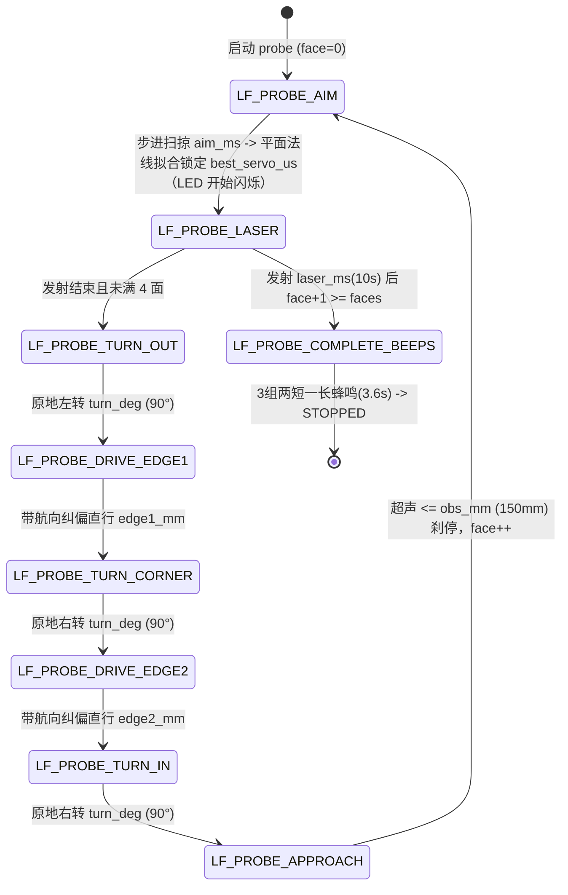

# 队友交接指南：全软件任务架构与四面激光打靶（蓝牙标定/录数）开发手册

> **交接背景**：纯硬件模拟电路循迹已改板实车跑通（详见 [pure-analog-rework-and-calibration.md](pure-analog-rework-and-calibration.md)），软件闭环循迹与电机死区/前馈标定均已完成并归档。  
> **当前版本**：已完成**全部软件任务的主体状态机框架与蓝牙标定/采集工具链**，插上 STM32G474 核心板即可直接开展**提高部分（2）四面顺时针目标探测与 10 秒激光打靶**的实车标定与优化。

---

## 零、2026-11-22 进展补记（先读这段）

> 本文件正文写于 M1 之前，描述的是「8 阶段矩形绕行」框架（即 M1 过渡流程，`probe_scan_mode=0` 时仍可用）。
> 现在的实现已按**侧视横扫（模式 B）**重构；**当前参数默认值、日志格式、状态机以 [接口契约_M1.md](../../接口契约_M1.md)、[手册_M1-M5实施步骤.md](../../手册_M1-M5实施步骤.md) 为准**。

| 里程碑 | 状态 | 关键内容 |
| --- | --- | --- |
| M1 | ✅ 已烧录并台架验证 | 两段式 AIM（粗扫 ±30°/10 点 + 细扫 ±12°/10 点）输出 `face.phi/rho/rms/hits`；`PROBE_FACE` 日志 |
| M2 | ✅ 已烧录 + 4 次台架全流程验证 | 侧视横扫 `SIDE_LOCK → SIDE_SCAN → SIDE_MOVE(+VERIFY) → LASER`；台架命令 `side` / `side push`；11 个 `probe_side_*` 参数；**M2 阶段自动流程保持 M1**（AIM→正面 LASER），**M3 已接入** `AIM→TURN_PAR→SIDE_LOCK` |
| M3 | ✅ 代码+单测，宽→窄台架通过；⏳ Gate 0 | `TURN_PAR` 接在 AIM 后；`LEG` = DRIVE1→TURN→DRIVE2（**无 ALIGN**），宽→窄下一面 `h=215 ok=1`、`w=43.6 NARROW`、`TURN 90/91` 实车左转；`BOARD_SWAP_LR=0`、`track_mm=112.5`。**2026-11-23 实车通过 G0-2（TURN_PAR `-90.4/-91.0`）与 G0-4（faces=2 自动，面2 `w=65.9 NARROW`）**；G0-3 窄→宽待跑。详见 **[M3-task-handover.md](M3-task-handover.md)** |
| M4 | 🚧 Gate 0 进行中（G0-2/G0-4 已过，G0-3 待跑） | 已落地：LEG 侧距连续采样、沿面 60 mm 平移测斜、`seg=BACKUP`、宽窄判据 100、锁定容差 70；计划：四面循环、回 AIM 重试、h_pred/pred 跨面、`probetour`、参数/Flash 8。见 [M4计划_评审与修订.md](../../M4计划_评审与修订.md) 与 [M4-gate0-20261123.md](M4-gate0-20261123.md) |
| M4f | ✅ 已烧录（2026-11-24 20:31） | AIM 改 **0~180° 全行程 + 角域边界法**（φ/宽度由两条棱边决定，TLS 主轴 + γ 补偿）；**二次微调重新启用、死区 1°**；**打靶精度仍未解决** → 见下方 ⚠ 与 [M4f-aim-boundary-20261124.md](M4f-aim-boundary-20261124.md) |
| M5 | ⏳ | 参数冻结、`probe_dry_run`、报告与日志归档 |

> ⚠ **当前未解决（2026-11-24 交接重点）**：四面全流程能跑通（145.7 s、四面 `SIDE_LOCK ok=1 warn=0`），
> 但**光斑稳定偏向小车后方**，宽面五等分（30 mm/带，2/4/6/4/2）时得分只有 **2~4 分**。
> 已排除：e≈0（激光与超声装在一起）、中点算错（两遍独立扫描只差 9.1 mm）、停车不可复现（±10 mm）、点数太少。
> 唯一剩下的候选：**激光与声波轴线有固定夹角 α**（光斑偏移 = `h·tanα`，h 四面相近 → 表现为常数、同侧）。
> 判定方法（10 分钟、不驱动电机）与一行修法见 [M4f-aim-boundary-20261124.md](M4f-aim-boundary-20261124.md) §6。

### 新增 / 变更的命令

| 命令 | 作用 |
| --- | --- |
| `side` / `side push` | M2 台架侧扫：自走 / 电机断电、人工沿面推车（跳过 AIM，直接 SIDE_LOCK） |
| `leg` | M3 台架单段绕行：直接用当前 side 的 w/h 跑 DRIVE1→TURN→DRIVE2；**不要再先 `side`**，否则面序锁存重置 |
| `turn DEG [SPD]` / `drive MM [SPD]` | 单段转向/直行标定；`turn +` = 左转（要求 `BOARD_SWAP_LR=0`） |
| `set probe_scan_mode 0/1` | 0 = M1 过渡流程（AIM→正面 LASER）；1 = 侧视（默认；**M3 起自动流程 `AIM→TURN_PAR→SIDE_LOCK`，不再保持 M1**） |
| `set probe_side_us/left/spd_mm_s/reach_mm/band_mm/jump_mm/verify` | 侧扫参数（默认 2400 / 1 / 50 / 260 / 15 / 40 / 1） |
| `set probe_beam_half_deg` / `probe_pan_x_mm` / `probe_fit_rms_mm` | γ=7.5°（只影响宽度）/ 云台前移 30 mm / 面拟合 rms 门限 15 mm |
| 新日志 | `PROBE_MODE`、`PROBE_SIDE_LOCK`、`PROBE_SIDE_EDGE`、`PROBE_SIDE_MID`、`PROBE_SIDE_FAIL`、`PROBE_SIDE_CFG`（格式见契约 §4） |

> **下文旧表已过时**（M1 之前冻结的默认值）：`probe_sweep_us` 600→**300**（粗扫半幅；单面测试编译开关会覆盖成 600）、`probe_step_us` 75→**60**、舵机行程→**600~2400 µs**、`probe_side_band_mm`=**15**、`probe_side_jump_mm`=**40**。


## 一、全部软件任务总览与当前就绪状态

| 软件任务模块 | 核心状态机 / 触发方式 | 当前状态 | 关键代码位置 |
| :--- | :--- | :---: | :--- |
| **1. 软件高速循迹** | `LF_CALIBRATING` -> `LF_ARMING (2s)` -> `LF_TRACKING`（按 `SW2` 或蓝牙 `start`） | ✅ 已跑通（后续可继续提速优化） | [Control/line_follower.c](../Control/line_follower.c) |
| **2. 超声波 `<15cm` 避障刹停** | 循迹中超声连续命中 `<= 150 mm` -> `LF_OBSTACLE_STOP`（主动短接制动 + 停车灯常亮 + 1s 长鸣；行驶期间舵机锁中位保证测距朝前） | ✅ 已集成并过单测 | [Control/line_follower.c](../Control/line_follower.c) |
| **3. 停车后自动寻找“垂直位置”** | `LF_OBSTACLE_STOP` 后 300 ms 自动进入 `LF_PROBING/AIM`：舵机步进扫掠 + `1/r=a·cosθ+b·sinθ` 最小二乘拟合求平面法线，锁定角度后核心板 LED 150 ms 周期闪烁 | ✅ 已实现并新增 `probeaim` 精度单测 | `step_probing()` / 模块 8a `probe_fit_normal()` |
| **4. 四面顺时针目标探测与 10s 打靶** | 在 `LF_OBSTACLE_STOP` 或 `LF_STOPPED` 下按 `SW3` 或蓝牙 `probe` -> `LF_PROBING`（8 阶段矩形绕行 + 3 组两短一长结束提示） | ✅ **完整可调框架已就绪，待实车标定几何/云台参数** | [Control/line_follower.c](../Control/line_follower.c#L807-L925) |
| **5. 蓝牙串口数据采集与在线标定** | `host_station.py`：`mcal` / `push` / `capture` / **`probe-scan`** / **`probe-odom`** / **`probe-run`** | ✅ **已全部打通并过自检** | [tools/host_station.py](../tools/host_station.py) |

---

## 二、四面打靶 (`LF_PROBING`) 8 阶段状态机架构

为了让小车可靠绕过方形/柱状障碍物四面，固件实现了完整的 **8 阶段矩形绕行状态机**（所有角度、距离、速度、时长均支持蓝牙实时调节，无需反复烧录）：



### 全部可调参数表（蓝牙 `set <参数名> <数值>`）

| 蓝牙参数名 | 结构体字段 (`LfProbeConfig`) | 默认值 | 合法范围 | 物理含义与现场调参说明 |
| :--- | :--- | :---: | :---: | :--- |
| **`servo_us`** | `cfg.servo_center_us` | `1500` | `900..2100` | 云台舵机正对正前方的机械中位脉宽 ($\mu\text{s}$) |
| **`obs_mm`** | `cfg.obstacle_stop_mm` | `150` | `50..500` | 避障停机与打靶逼近刹停的超声距离阈值 ($\text{mm}$) |
| **`probe_cw`** | `probe.clockwise` | `1` | `0` / `1` | `1` = 顺时针绕行四面（任务书要求），`0` = 逆时针 |
| **`probe_faces`** | `probe.faces` | `4` | `1..4` | 目标平面总数；**初期调试建议先设为 `1` 或 `2`** |
| **`probe_aim_ms`** | `probe.aim_ms` | `2000` | `200..5000` | 单面瞄准总时长 ($\text{ms}$，含前 150 ms 归起点稳定，其余时间均分为离散扫描点) |
| **`probe_sweep_us`** | `probe.sweep_us` | `600` | `20..600` | 相对中位的单侧扫掠半幅 ($\pm\text{us}$，默认覆盖满量程 $900..2100\ \mu s$) |
| **`probe_step_us`** | `probe.scan_step_us` | `75` | `20..200` | 步进扫掠相邻采样点脉宽间隔 ($\text{us}$)；越小角度越密，单点驻留时间越短（自动保证 $\ge 60$ ms） |
| **`probe_laser_ms`** | `probe.laser_ms` | `10000` | `200..30000` | 单面激光+蜂鸣器同步发射时长；**联调时可先设为 `2000` 省时间** |
| **`probe_turn_deg`** | `probe.turn_deg` | `90.0` | `30..180` | 每次 90° 原地转向的目标角度；若地面打滑偏少可微调至 `92~96` |
| **`probe_edge1_mm`** | `probe.edge1_mm` | `220.0` | `30..1500` | 阶段 4：离面越过拐角的直行距离（约 $\frac{W}{2} + D$） |
| **`probe_edge2_mm`** | `probe.edge2_mm` | `220.0` | `30..1500` | 阶段 6：沿侧面走至下一面中心垂线的直行距离（约 $\frac{L}{2} + D$） |
| **`probe_approach_mm`** | `probe.approach_max_mm` | `260.0` | `30..1000` | 阶段 8：逼近下一面的最大前移安全距离（防止超声漏检一直往前开） |
| **`probe_turn_spd`** | `probe.turn_speed_mm_s` | `90.0` | `20..300` | 原地转向时的单轮线速度 ($\text{mm/s}$) |
| **`probe_drive_spd`** | `probe.drive_speed_mm_s` | `120.0` | `20..400` | 绕边直行时的目标线速度 ($\text{mm/s}$) |
| **`probe_approach_spd`** | `probe.approach_speed_mm_s` | `85.0` | `20..300` | 逼近下一平面时的缓慢线速度 ($\text{mm/s}$) |

---

## 三、蓝牙串口标定与实车联调标准 5 步流程

> ⚠️ **注意**：本固件采用 **RAM-first** 策略（不自动写 Flash 保护芯片寿命），每次单片机断电重启后，请先执行一次 `push` 将电脑保存的地面电机死区曲线下发至小车 RAM。

### 第 1 步：确认蓝牙连接与硬件外设自检
```powershell
# 1. 查看并绑定默认蓝牙端口（如 COM10）
python tools/host_station.py ports
python tools/host_station.py set-port COM10

# 2. 查看按键、编码器、超声与供电状态
python tools/host_station.py cmd "io" "us"

# 3. 逐项点亮外设自检（安全不转电机）
python tools/host_station.py cmd "outtest lamp 1 1000"
python tools/host_station.py cmd "outtest buz 1 800"
python tools/host_station.py cmd "outtest laser 1 1500"
python tools/host_station.py cmd "outtest servo 1500 1500"
# 或让舵机连续往返扫掠，直到 Ctrl+C / stop（默认 2 s 一个 900->2100->900 周期）
python tools/servo_sweep.py --port COM3 --period 2000
```

### 第 2 步：下发地面电机前馈曲线（消除左右轮跑偏）
```powershell
# 直接把已标定好的 data/latest_calibration.json 下发至小车 RAM
python tools/host_station.py push --mode GROUND

# （若更换了新电池或电机，可重新跑 5 轮地面带载自动标定）
# python tools/host_station.py mcal --mode ground --passes 5
```

### 第 3 步：蓝牙标定云台机械中位与超声波瞄准曲线（`probe-scan`）
将小车正对障碍物平面中心约 `15 cm` 处停稳，运行：
```powershell
python tools/host_station.py probe-scan --span 240 --step 20 --dwell 140
```
- 上位机会自动录制每一档 `(servo_us, obs_mm)` 到 `data/probe_scan_<时间戳>.csv`，并计算超声距离谷底对应的 **`recommended_servo_center_us`**。
- 若实测机械中位偏离 `1500`（例如 `1540`），立即用 `set servo_us 1540` 修正（稳定后可改写到 `Control/line_follower.c` 默认值中）。

### 第 4 步：蓝牙标定直行距离与原地 90° 转弯精度（`probe-odom`）
```powershell
# 1. 标定直行 300 mm：用尺子量小车实际前行距离，与里程计 actual_mm 对比
python tools/host_station.py probe-odom drive 300 --speed 120 --push

# 2. 标定原地左转 90°（正=左转CCW，负=右转CW）：用量角器核对实际转角
python tools/host_station.py probe-odom turn 90 --speed 90 --push
python tools/host_station.py probe-odom turn -90 --speed 90 --push
```
- **标定修正公式**：
  - 若实测转角偏小（如只转了 `85°`）：可增大轮距 `set track_mm <原值 * 90 / 85>` 或直接调大 `set probe_turn_deg 95`。
  - 若实测直行距离偏短（如只走了 `285 mm`）：可减小轮径 `set wheel_mm <原值 * 285 / 300>`。

### 第 5 步：蓝牙一键试跑打靶任务并全程录制 `PROBE` 遥测（`probe-run`）
```powershell
# 1. 先用单面 + 2秒激光 快速验证瞄准与激光发射
python tools/host_station.py probe-run --push --faces 1 --laser-ms 2000

# 2. 验证 4 面完整绕行轨迹（先用 2秒激光 省时间，标定好 edge1/edge2/turn-deg）
python tools/host_station.py probe-run --push --faces 4 --laser-ms 2000 --edge1 220 --edge2 220 --turn-deg 90

# 3. 正式全流程 4 面 × 10 秒打靶 + 3组两短一长验收（全程录数至 data/probe_run_*.csv）
python tools/host_station.py probe-run --push --faces 4 --laser-ms 10000 --edge1 220 --edge2 220 --turn-deg 90
```

---

## 四、编译、单测与烧录命令速查

所有构建均封装在 [tools/build.ps1](../tools/build.ps1) 中：

```powershell
# 编译 Debug / Release STM32G474 固件
.\tools\build.ps1 -Configuration Debug
.\tools\build.ps1 -Configuration Release

# 编译并烧录至 STM32G474（ST-LINK 必须插在主扩展板边缘 J_SWD 座！）
.\tools\build.ps1 -Configuration Debug -Flash

# 运行全部 27 项 PC 主机端单元测试（每次改完 Control/line_follower.c 必跑！）
.\tools\build.ps1 -Test

# 运行蓝牙上位机算法与协议自检
python tools/host_station.py --selftest
```

---

## 五、二次开发与算法优化入口指引

1. **打靶瞄准算法（已完成：步进扫掠 + 平面法线最小二乘拟合）**：
   - 实现见 [Control/line_follower.c](../Control/line_follower.c) 模块 8a：`probe_scan_plan()` 规划离散角度点、`case LF_PROBE_AIM` 逐点驻留采样、`probe_fit_normal()` 对 `1/r = a·cosθ + b·sinθ` 做最小二乘并输出法线方向（残差 >12% 时自动退回三点平滑最小值）。
   - 现场若发现扫掠角度覆盖不足，用 `set probe_sweep_us 600` / `set probe_step_us 50` / `set probe_aim_ms 2400` 在线调整；瞄准结果由 `PROBE_LOCK,face=,servo_us=,angle_deg=,dist_mm=,points=` 回传。
2. **改进绕障路径（如边走边用超声测角、动态识别障碍物宽度）**：
   - 修改 [Control/line_follower.c](../Control/line_follower.c) 中的 `LF_PROBE_DRIVE_EDGE1` / `LF_PROBE_DRIVE_EDGE2` / `LF_PROBE_APPROACH`。
3. **固化现场标定好的默认参数**：
   - 调出最优参数后，直接写回 [Control/line_follower.c](../Control/line_follower.c) 的 `lf_default_config()`，重新编译烧录即可断电永久保存。
4. **硬件接口逐脚定义与排错**：
   - 详见 [docs/hardware-interface-manual.md](hardware-interface-manual.md) 与 [docs/codebase-guide.md](codebase-guide.md)。
